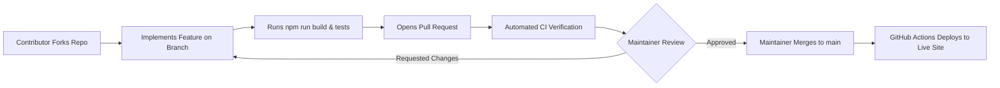

# Contributing to Studyverse

Welcome to **Studyverse — IIT Madras Virtual Campus**! We are delighted that you are interested in improving this virtual study environment for students around the world.

Studyverse is an ambient, tranquil virtual campus simulation designed around quiet companionship, focus, and productivity. To preserve this serene experience and maintain strict code quality, Studyverse operates under a **maintainer-controlled contribution model**.

---

## 🏛️ Maintainer-Controlled Philosophy

- **Repository Ownership:** This repository is maintained and curated by [@lucky-pluton](https://github.com/lucky-pluton).
- **No Direct Write Access:** Outside contributors, students, and collaborators do not have direct push or write access to the repository or its `main` branch.
- **Fork-and-Pull-Request:** All contributions—whether feature enhancements, architectural refinements, documentation updates, or bug fixes—must be submitted through a personal fork and a Pull Request.
- **Review & Approval:** Every Pull Request is reviewed by the maintainer. Only pull requests that receive explicit maintainer approval and pass automated build checks are merged into `main`.
- **Production Deployment:** Merging an approved Pull Request into `main` automatically triggers deployment to the live GitHub Pages site ([https://lucky-pluton.github.io/studyverse/](https://lucky-pluton.github.io/studyverse/)). Contributors cannot deploy directly to production.

---

## 🚀 Getting Started: Fork-and-Pull-Request Workflow

Follow these steps to propose changes:

### 1. Fork the Repository
Click the **Fork** button in the upper right corner of [https://github.com/lucky-pluton/studyverse](https://github.com/lucky-pluton/studyverse) to create a copy of the repository in your personal GitHub account.

### 2. Clone Your Fork Locally
Clone your newly forked repository to your development machine:
```bash
git clone https://github.com/<your-username>/studyverse.git
cd studyverse
```

### 3. Configure Upstream Remote
Keep your fork up-to-date by connecting it to the original repository:
```bash
git remote add upstream https://github.com/lucky-pluton/studyverse.git
git fetch upstream
```

### 4. Create a Focused Branch
Always branch off the latest `upstream/main` with a clear, descriptive name:
```bash
git checkout -b feat/your-feature-name
# or
git checkout -b fix/issue-description
```

### 5. Install Dependencies
```bash
npm install
```

### 6. Run and Test Locally
Launch the local development environment:
```bash
npm run dev
```
Open `http://localhost:5173` in your browser. If testing multiplayer presence or chat features, open a companion window using the in-app companion button or open a second incognito/private browser window.

### 7. Verify Types, Builds & Tests
Before committing, ensure your changes compile with zero TypeScript errors and pass automated suites:
```bash
# Verify TypeScript and build bundle
npm run build

# Run automated test verification
node test_dnd_suite.cjs
```
Pull Requests with failing builds cannot be merged.

### 8. Commit Your Changes
Make clean, focused commits with meaningful commit messages:
```bash
git add .
git commit -m "feat(location): add interactive study notes to Central Library"
```

### 9. Push to Your Fork
```bash
git push origin feat/your-feature-name
```

### 10. Open a Pull Request
1. Navigate to the original repository: [https://github.com/lucky-pluton/studyverse](https://github.com/lucky-pluton/studyverse)
2. You will see a banner prompting you to create a Pull Request from your branch.
3. Complete the [Pull Request Template](.github/pull_request_template.md) with thorough details:
   - The problem or feature addressed.
   - Specific code and UI changes.
   - Screenshots / screen recordings (especially for visual or UI changes).
   - Tests performed across desktop and mobile screen widths.
   - Any potential side effects on presence, performance, or existing locations.

---

## 🎨 Design & Architectural Guidelines

When crafting contributions, please align with Studyverse's core principles:

1. **Quiet Companionship Over Social Media:**
   - Studyverse is a productivity sanctuary. Avoid adding intrusive social networking mechanics, gamified streaks, vanity follower counts, or aggressive popups.
   - Chat and interaction must remain strictly location-scoped, non-compulsory, and easily silenced via **Do Not Disturb (DND) Mode**.

2. **Chibi Avatar Aesthetics:**
   - Visual character art must strictly adhere to the chibi-inspired 2D illustration system (cute proportions, expressive eyes, location-appropriate sitting poses).
   - Do not replace chibi characters with real-world photographs, generic stock icons, or 3D models.

3. **Multiplayer Presence Architecture:**
   - Studyverse utilizes a multi-tier presence protocol (WebRTC cloud mesh over Port 443 WSS Nostr relays, Supabase Realtime, and BroadcastChannel for local multi-tab sync).
   - Never disrupt presence payloads or introduce blocking network calls that could cause seat desynchronization.

4. **Spec-Driven Development (OpenSpec):**
   - Major capabilities are documented as formal specifications under `openspec/specs/`.
   - When introducing or altering a capability, update or add the corresponding OpenSpec specification file.

5. **No Embedded Secrets:**
   - Never commit API keys, service role credentials, or sensitive tokens to Git. Use environment variables (`.env`) with demo-safe fallbacks.

---

## 🔍 Pull Request Review Lifecycle



1. **Automated CI Checks:** Once opened, GitHub Actions runs the build and verification suite on the PR branch.
2. **Maintainer Review:** The repository owner [@lucky-pluton](https://github.com/lucky-pluton) inspects the code, verifies visual consistency, and tests behavior.
3. **Feedback & Iteration:** The maintainer may leave comments or request modifications. Push new commits to your branch to automatically update the PR.
4. **Merge & Production Deploy:** Once approved, the maintainer merges the PR into `main`, which automatically builds and publishes the new release to the production site.

---

## 🐛 Reporting Bugs & Suggesting Features

- **Reporting a Bug:** If you encounter unexpected behavior, please use the [Bug Report Template](.github/ISSUE_TEMPLATE/bug_report.md). Include steps to reproduce, browser/OS specifications, and relevant screenshots or console output.
- **Suggesting a Feature:** If you have an idea to enhance the virtual campus, please open an issue using the [Feature Suggestion Template](.github/ISSUE_TEMPLATE/feature_request.md) so it can be discussed before implementation.

---

## 📄 Intellectual Property & Licensing

Studyverse is an independent, proprietary project created and maintained by [@lucky-pluton](https://github.com/lucky-pluton).

- Submitting a pull request or issue does not grant the contributor ownership, intellectual property rights, or write authority over the repository or production deployments.
- By submitting a pull request, you agree that your contribution may be reviewed, modified, merged, or rejected at the sole discretion of the project maintainer.
- The repository's licensing status remains strictly under the authority of the repository maintainer; contributors may not introduce different licenses or change repository licensing terms.

---

Thank you for helping make Studyverse a serene, focused campus for students everywhere! 🏛️✨
